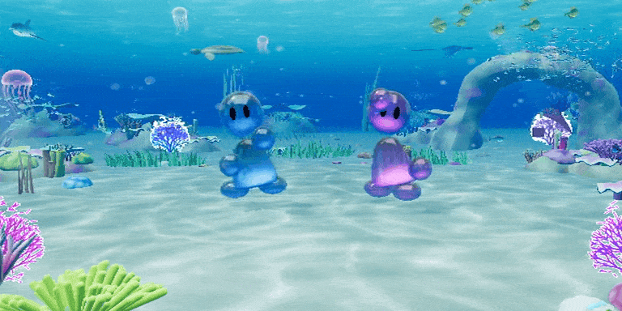

<div align="center">
# aerodance
</div>

<p align="center">
  
</p>


An open-source Frutiger Aero dance game. Dance in front of a webcam or your phone's camera:
pose tracking runs in the browser and scores you against the routine. Play it at
[aerodance.party](https://aerodance.party).

```sh
npm install
npm run dev
```

Then open http://localhost:5173.

## Docs

- [Developer guide](docs/README.md): how the game works, running, testing and deploying it
- [Dance Studio](tools/choreography/README.md): recording and editing routines into song bundles
- [Apple TV](apps/tvos/README.md) and [the rest of the docs](docs/)
